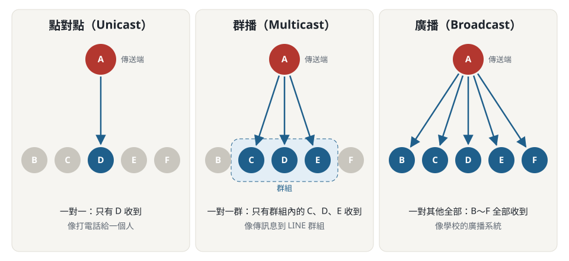

# 第二章 基礎網路觀念 — 重點整理

> 標記：⭐ 小考已考過　⚠️ 投影片有誤或易混淆　📌 易考數字／名詞　❌ **我答錯過**

---

## ❌ 我的錯題總覽（2026-11-01「第二章 30 題」：14/30，47 分）

| 小節 | 錯幾題 | 錯在哪 |
|---|---|---|
| 2-1 網路範圍 | 2 | WAN、PAN 認錯成 LAN |
| 2-3 常見伺服器 | **4** | Proxy、WWW、應用程式、資料庫伺服器的功能混在一起 |
| 2-4 網路架構 | **3** | WWW 是主從式、混合式的定義、雲端由主從式衍生 |
| 2-6 傳輸數量 | 1 | 群播、廣播搞混 |
| 2-7 節點／主機 | 2 | 節點、主機的定義 |
| 2-8 基頻／寬頻 | 1 | 寬頻上網的英文是 Wideband |
| 2-10 速率計算 | **3** | 忘了 ÷8、ATM 效率、KB 的單位 |

> 最弱：**2-3 伺服器**、**2-4 架構**、**2-10 計算**，這三節先複習。

---

## 2-1 不同範圍的網路類型（依規模／範圍／距離）📌
| 類型 | 全名 | 範圍 | 例子 |
|---|---|---|---|
| **PAN** ❌ | Personal Area Network 個人網路 | 人身周邊裝置 | 藍牙耳機 |
| **LAN** | Local Area Network 區域網路 | 約 **2 公里以內** | 一棟建築、辦公室、家裡 |
| **MAN** | Metropolitan Area Network 都會網路 | 約 **2～10 公里** | 特定城市內校園各大樓 |
| **WAN** ❌ | Wide Area Network 廣域網路 | 約 **10 公里以上** | 跨縣市、跨國 |

- **網際網路 Internet**：透過 **TCP/IP** 把個別網路連起來形成的大網路 → 世界上**最大**的網路

> ❌ **我的錯誤**
> - 「10 公里以上、跨縣市跨國」→ 我選 LAN，正解 **WAN**
> - 「人身周邊裝置連起來的網路」→ 我選 LAN，正解 **PAN**
>
> 💡 記法：看第一個字母。**P**ersonal 個人 < **L**ocal 區域 < **M**etropolitan 都會 < **W**ide 廣域；數字 **2 / 10** 是分界（LAN ≤ 2 km < MAN ≤ 10 km < WAN）

## 2-2 網路作業系統
- **OS**：控制基本輸入輸出（MS-DOS、Windows 3.1）
- **NOS（Network Operating System）**：具有網路連線功能的作業系統（Windows 95 以後、Unix/Linux）
- 分兩類：
  | 類別 | 特性 | 例子 |
  |---|---|---|
  | **伺服器端** NOS | 安裝時**內建**伺服器程式，提供服務／資源 | Windows NT/2000/2003/2008…/2019/2022 Server、Unix、Linux |
  | **用戶端** NOS | **不內建**或只支援部分伺服器功能，當工作站 | Windows 95/98/Me/XP/Vista/7/8/10/11 |

## 2-3 常見的伺服器 ❌（錯 4 題，最弱）
| 伺服器 | 功能 | 🔑 題目關鍵字 |
|---|---|---|
| 檔案伺服器 | 檢索與存儲檔案 | 存「檔案」 |
| 印表機伺服器 | 提供列印服務 | 列印 |
| **應用程式伺服器** ❌ | 存放程式供下載、執行 | 「下載、**執行**程式」 |
| **資料庫伺服器** ❌ | 持續儲存交易與使用者資料 | 「**交易**、使用者資料」 |
| **WWW 伺服器** ❌ | 存放網頁（HTML） | 「**HTML**、瀏覽器」 |
| FTP 伺服器 | 檔案上下傳 | 檔案「傳輸」 |
| E-mail 伺服器 | 寄信、收信 | 郵件 |
| **Proxy 伺服器** ❌ | 改善服務品質，**減少等待時間**（快取） | 「改善品質、**減少等待**」 |
| BBS 伺服器 | 電子佈告欄 | 佈告欄（只有這個意思！） |

> ❌ **我的錯誤**
> - 「改善服務品質、減少 WWW 等待時間」→ 我選 BBS，正解 **Proxy**
> - 「存放 HTML、供瀏覽器解譯」→ 我選應用程式伺服器，正解 **WWW 伺服器**
> - 「存放程式，供用戶端下載、執行」→ 我選檔案伺服器，正解 **應用程式伺服器**
> - 「持續儲存交易和使用者資料」→ 我選 BBS，正解 **資料庫伺服器**
>
> 💡 記法：照上表「關鍵字」欄對答案。**BBS 只等於電子佈告欄**，看到其他功能描述都不要選它；「檔案」和「程式」要分清楚：存檔案 → 檔案伺服器，執行程式 → 應用程式伺服器

## 2-4 Client 與 Server 網路架構 ❌（錯 3 題）
| 架構 | 說明 |
|---|---|
| **主從式**（Client/Server）❌ | 一部以上伺服器，其他當用戶端；**WWW 網站**採此架構 |
| **對等式**（Peer to Peer, **P2P**） | 每台都存資料、既發請求也處理請求 → **自身既是 Client 也是 Server** |
| **混合式**（Hybrid）❌ | **同時存在主從式與對等式**，常見於內部區網 |
| 雲端運算架構 ❌ | 雲端伺服器＋**精簡型用戶端（thin client）**，由**主從式衍生** |

> ❌ **我的錯誤**
> - 「WWW 網站採用哪種架構」→ 我選對等式，正解 **主從式**
> - 「同時存在主從式與對等式」→ 我選對等式，正解 **混合式**
> - 「雲端運算由哪種架構衍生」→ 我選混合式，正解 **主從式**
>
> 💡 記法：
> - 有一台「**伺服器**」專門提供服務、其他人來連 → **主從式**（WWW 網站、雲端都是：Google 伺服器提供、你的電腦來用）
> - 每台**互相**分享、沒有專門的伺服器 → **對等式 P2P**（BT 下載）
> - 題目說「**兩種同時存在**」→ 就是**混合式**，名字就是「混」在一起

## 2-5 通訊傳輸模式（依傳輸方向）📌
| 模式 | 說明 | 生活例子 |
|---|---|---|
| **單工** Simplex | 只有單方向，永遠「發送端 → 接收端」 | 廣播電台、電視 |
| **半雙工** Half Duplex | 可收可發，但**不能同時** | 無線對講機 |
| **全雙工** Full Duplex | **同時**收與發 | 電話 |

## 2-6 網路傳輸數量分類 ❌
| 形式 | 說明 |
|---|---|
| **點對點**（Unicast） | 一對**一** |
| **群播**（Multicast）❌ | 一對**一群** |
| **廣播**（Broadcast） | 一對**其他全部** |

- 判斷方法：看**誰會收到**。只有指定的 1 台 → 點對點；只有「群組內」的那幾台 → 群播；同網路上**所有**其他電腦 → 廣播
- 群播 vs. 廣播：群播的接收者要**先加入群組**，沒加入的不會收到；廣播不挑對象，全部都收到

> ❌ **我的錯誤**：「一個節點對**一群**節點」→ 我選廣播，正解 **群播**
>
> 💡 記法：「**群**播 = 一**群**」，字面就是答案；廣播 = 「全部」

## 2-7 網路節點、主機、路由器 ❌（錯 2 題）
- **節點** ❌：使用 TCP/IP、**具有一個 IP 位址**的電腦或網路設備（電腦、路由器都算）
- **主機** ❌：**提供或接受**服務的電腦，**無路由功能**
- **路由器**：網路設備，**具路由功能**

> ❌ **我的錯誤**
> - 「主機與路由器的差別」→ 我選「主機只能接受服務、不能提供服務」，正解 **主機無路由功能，路由器有**
> - 「網路節點的定義」→ 我選「必須是提供服務的伺服器」，正解 **使用 TCP/IP 且有一個 IP 位址的電腦或網路設備**
>
> 💡 記法：
> - **節點 = 有 IP 就算**，不挑是不是伺服器
> - **主機「提供或接受」都可以**，跟路由器差在「**有沒有路由功能**」

## 2-8 訊號傳輸方式：基頻 vs. 寬頻 📌
| 項目 | **基頻 Baseband** | **寬頻 Broadband** |
|---|---|---|
| 訊號 | **數位**訊號（方波） | **類比**訊號（正弦波） |
| 是否需調變 | **不需要**調變 | 需要**調變器** |
| 方向性 | **雙向** | **單向** |
| 距離 | 較**短** | 較**遠** |
| 多頻道技術 | **分時多工 TDM** | **分頻多工 FDM** |
| 使用網路 | **區域網路 LAN** | **廣域網路 WAN** |

> ⚠️ ❌ 廣告說的「寬頻上網」是 **Wideband**，不是這裡的 **Broadband**，只是中文譯名剛好相同。
>
> ❌ **我的錯誤**：「寬頻上網的寬頻英文」→ 我選 **Baseband**（那是「基頻」！），正解 **Wideband**
>
> 💡 記法：三個詞要分清楚：**Base**band = **基**頻（LAN）；**Broad**band = 本章的寬頻（WAN）；**Wide**band = 廣告的「寬頻上網」

## 2-9 常見網路名詞
| 名詞 | 定義 | 單位 |
|---|---|---|
| 位元 bit | 資料最基本單位（0 或 1） | — |
| 位元組 Byte | **8 bits** | 1 Byte = 8 bits |
| 位元率 | 傳輸速率 | **bps** |
| 頻寬 | 數位訊號在網路上的**最高**位元率 | bps |
| **鮑率** | 每秒傳送的**訊號單元數目** | **鮑（baud）** |
| 頻率 | 單位時間內事件重複次數 | **赫茲 Hz** |

## 2-10 網路傳輸速率的計算 ❌（錯 3 題）
- 1 KB = 2¹⁰ = **1024 Byte** ❌（約 10³）；1 MB = 2²⁰；1 GB = 2³⁰
- **重點：網路速率以 bit 計，電腦檔案以 Byte 計 → 除以 8** ❌

### 範例 1：100 Mbps 傳 50 MB 檔案
- 100 Mbps ÷ 8 = **12.5 MB/s** ❌（實際超過 10 MB/s 就算正常）
- 50 ÷ 12.5 = **4 秒**

### 範例 2：ADSL 512 Kbps 傳 50 MB 檔案
- 512 Kbps ÷ 8 = **64 KB/s**（實際約 50 KB/s 算正常）
- ATM Cell 固定 **53 Bytes**、表頭 **5 Bytes** → 效率約 48/53 ≈ **90.5%** ❌
- 64 × 90.5% = **57.92 KB/s**
- 50 × 1000 ÷ 57.92 ≈ **863.26 秒**

> ❌ **我的錯誤**
> - 「100 Mbps 每秒傳多少 Byte」→ 我選 100 MByte（**忘了 ÷8**），正解 **12.5 MByte**
> - 「ATM Cell 傳輸效率」→ 我選 9.4%（那是**表頭**佔的比例 5/53），正解 **90.5%**（**資料** 48/53）
> - 「1 KB 等於多少」→ 我選 1024 **bits**，正解 1024 **Byte**
>
> 💡 記法：
> - 看到 **小寫 b**（Mbps、Kbps）= bit → 換成檔案大小要 **÷8**；**大寫 B**（MB、KB）= Byte
> - 效率 = **有用的資料** ÷ 全部 = 48 ÷ 53；表頭是「浪費」的部分，不是效率
