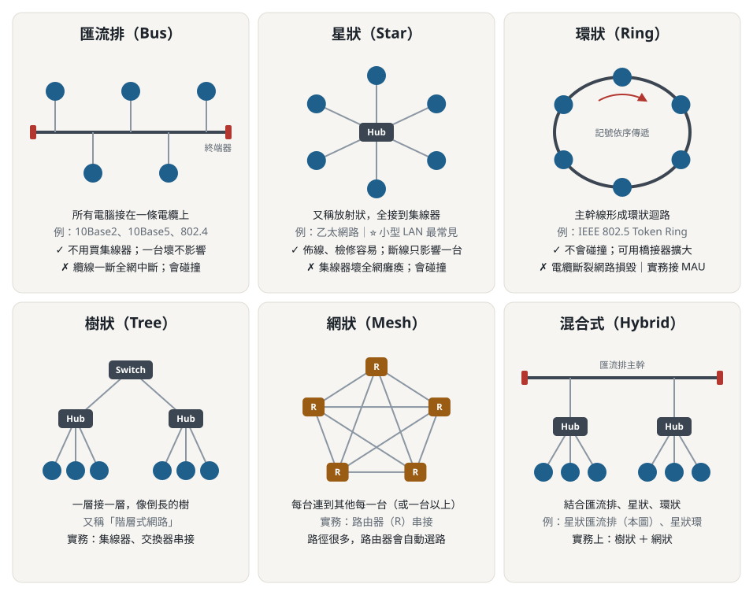

# 第四章 傳輸媒介和網路設備 — 重點整理

> 標記：⭐ 小考已考過　⚠️ 投影片有誤或易混淆　📌 易考數字／名詞

---

## 4-1 OSI 模型與網路設備的對應 ⭐
| 層級 | 實作的 OSI 層 | 設備 |
|---|---|---|
| **第 1 層設備**（實體層） | 第 1 層 | **數據機、中繼器、集線器** |
| **第 2 層設備**（資料鏈結層） | 第 **1、2** 層 | **網路卡**、**交換器**、**橋接器** |
| **第 3 層設備**（網路層） | 第 **1、2、3** 層 | **路由器**、**IP 分享器**、無線基地台 |

- ⭐ 考過：**網路卡支援第 1、2 層**；**路由器支援第 1、2、3 層**

## 4-2 傳輸媒介
- **網路定義**：透過網路設備與傳輸媒介，把**兩台以上**的電腦、伺服器或週邊連接，互傳資料並利用彼此資源
- **通訊三元素**：傳送**對象**、傳送**媒介**、傳送的**資料**
- 有線：雙絞線、同軸電纜、光纖；無線：無線電波、微波、衛星、紅外線、雷射

### 一、雙絞線（Twisted Pair）
- 兩根包絕緣材料的銅線**絞合成螺旋狀**
  - 作用：①減少訊號**衰減** ②減少**串音（crosstalk）**與**雜訊（Noise）**
- 分類
  | | **STP** 遮蔽式 | **UTP** 無遮蔽式 |
  |---|---|---|
  | 構造 | 多一層**金屬遮蔽** | 無金屬遮蔽 |
  | 價格 | 較**貴** | 較**便宜** |
  | 抗干擾 | 好 | 容易受干擾 |
  | 使用 | — | **目前最常用** |
- 優點：便宜、維護容易、佈線彈性好；缺點：不耐用、易受干擾

### 雙絞線等級 📌
| 等級 | 最高速率 | 用途 | 狀態 |
|---|---|---|---|
| Cat 1 | 2 Mbps | 語音（傳統電話線） | — |
| Cat 2 | 4 Mbps | 語音、4M 記號環 | 淘汰 |
| Cat 3 | 16 Mbps | **10BaseT**、16M 記號環 | 淘汰 |
| Cat 4 | 20 Mbps | 100BaseT4、16M 記號環 | 淘汰 |
| Cat 5 | 100 Mbps | **100BaseTX** | 淘汰 |
| **Cat 5e**（加強型） | **1000 Mbps** | **1000BaseT** | **主流** |
| **Cat 6** | 2.4 Gbps（頻寬 250 MHz） | 1000BaseT | **主流** |
| Cat 6a（增強型） | 10 Gbps（頻寬 **500 MHz**） | **10GBaseT** | 未來 |
| Cat 7 | 10 Gbps 以上（頻寬 600 MHz） | 10GBaseT | 未來 |

> ⚠️ Cat 6a / Cat 7 投影片的數字缺漏（只顯示「最高達 bps」），一般為 10 Gbps。

### 乙太網路接線
- 工具：網路線（建議 **Cat 5e 或 Cat 6**）、**RJ-45 接頭** ⭐、護套、壓線鉗、測線器
- **正常接線（直通線）**：PC ↔ Hub/Switch，**兩端皆 568B**
- **跳接線（交叉線）**：**PC ↔ PC、Hub ↔ Hub**，一端 **568A**、一端 **568B**
  - 原理：A 端 Tx 要接 B 端 Rx

### TIA/EIA 568 色序 📌
| 腳位 | **568A** | **568B** |
|---|---|---|
| 1 | 白綠 | **白橙** |
| 2 | 綠 | **橙** |
| 3 | 白橙 | 白綠 |
| 4 | 藍 | 藍 |
| 5 | 白藍 | 白藍 |
| 6 | 橙 | 綠 |
| 7 | 白棕 | 白棕 |
| 8 | 棕 | 棕 |

- 記法：568A 與 568B 只是 **1↔3、2↔6** 互換（綠、橙對調）
- 網路卡腳位：**1、2 = Tx（傳送）**；**3、6 = Rx（接收）**

### 二、同軸電纜（Coaxial Cable）
- 組成：導體、外遮蔽層、絕緣層、外部保護層
- **RG-8（50Ω）／RG-11（75Ω）→ 10Base5**；**RG-58A/U（50Ω）→ 10Base2**
- 優點：連通性佳、範圍廣、**抗干擾性很好**
- 缺點：接頭多易接觸不良、**一處故障影響整個網路**、診斷修復麻煩
- 現況：已被 UTP、光纖取代，但在**有線電視 CATV 的 Cable Modem** 仍是主流

### 三、光纖（Optical Fiber）
- 以**光**傳遞，**完全不受電波干擾**；外有 **cladding（披覆層）** 保護
- 優點：高頻寬（100 Mbps 以上）、衰減小**距離遠**、抗電磁干擾**保密性高**、適合**點對點**、輕巧；常作**遠程連線或骨幹**，有取代海底電纜趨勢
- 缺點：**價格與架設費高**、彎曲半徑不宜過小、終端處理不易、分路與熔接繁瑣
- **光纖到府**：交通部電信總局 **2004 年**引進；NCC 統計 FTTx 用戶 **2021 年 12 月突破 400 萬**

## 4-3 網路拓樸（Topology）
- 拓樸 = 網路裝置彼此間的**連接方式**
- 實際常見：**匯流排、環狀、星狀**及混合型；樹狀、網狀在電腦端多為學術討論，通訊設備實務上：樹狀＝集線器／交換器串接、網狀＝路由器串接

- 看圖判斷：**一條線**串起來 → 匯流排；**中間一台 Hub** → 星狀；**圍成一圈** → 環狀；**一層一層往下分** → 樹狀；**每台互連** → 網狀；**以上混搭** → 混合式

### 一、匯流排（Bus）
- 所有電腦接在**一條電纜**上；例：**10Base2、10Base5、IEEE 802.4 Token Bus**
- 優點：任一電腦壞不影響其他、**不用買集線器**
- 缺點：**纜線壞整個網路中斷**、檢修要從頭查到尾

### 二、星狀（Star）⭐ 小型 LAN 最常見
- 又稱「**放射狀**」，所有電腦接**集線器**；例：**Ethernet**
- 優點：管理效率佳、不易碰撞
- 缺點：**集線器故障全網癱瘓**、集線器可能**壅塞**成瓶頸

### 三、環狀（Ring）
- 主幹線形成**環狀迴路**（單環／雙環）；例：**IEEE 802.5 Token Ring**、IBM Token Ring
- 優點：相當於有廣播功能、**沒有碰撞問題**、可透過橋接器擴大
- 缺點：電纜斷裂導致整個或部分網路損毀；沒用 MAU 時檢修很麻煩
- **MAU / MSAU**（多站存取單元，唸「帽」）：讓記號環實體接成**星狀**

### 三種拓樸比較 📌
| | 匯流排 | 星狀 | 環狀 |
|---|---|---|---|
| 碰撞 | 會 | 會 | **不會** |
| 集線設備 | 無 | 有（Hub/Switch） | 有（MAU） |
| 佈線 | 困難 | **容易** | 困難 |
| 斷線網路毀損 | 會 | **不會** | 會 |
| 檢修 | 困難 | **容易** | 困難 |

### 其他拓樸
- **樹狀（Tree）**：又稱**階層式網路**；集線器、交換器串接
- **網狀（Mesh）**：一台接到其他每一台；路由器串接
- **混合式**：星狀匯流排、星狀環；**實務上 = 樹狀 + 網狀**

## 4-4 網路設備
### 網路介面卡（NIC）
- 電腦與網路線之間的介面；目前普及 **Gigabit（10/100/1000 Mbps）**
- 接頭：**RJ-45**；介面：**PCI、USB、PCMCIA**

### 中繼器（Repeater）— L1
- 把衰減的訊號**還原原本強度**再傳送；距離太長（約 **200～500 公尺**）會衰減

### 集線器（Hub）— L1
- **5-4-3 規則** 📌（10 Mbps 乙太網路）：最多 **5 個區段**、**4 個集線器**、只有 **3 個區段**可接電腦
- 串接用 **Up Link 埠**（現多為自動偵測）
- 三特點：①多埠的訊號放大器（中繼器） ②資訊**廣播到所有連接埠** ③集中管理、加入退出自由

### 交換器（Switch）— L2
- 又稱**智慧型集線器、Layer 2 交換器**，外觀和 Hub 幾乎一樣
- 📌 **與集線器最大差異**：交換器**每個埠有專屬頻寬**並具**資料交換**功能；**集線器所有埠共用一個頻寬**

### IP 分享器 — L3
- 功能類似 Hub，主要具 **DHCP 伺服器**（動態指派 IP），讓**多台 PC 分享一個 IP**

### 橋接器（Bridge）— L2
- 連接**不同網路區段**：兩個乙太區段、Token Ring ↔ 乙太、Mac ↔ PC、無線 ↔ 有線

### 路由器（Router）— L3
- 具中繼器、集線器、橋接器功能，外加**路由（Routing）**
- 提供**路徑選擇**與**流程控制**；用於大型 LAN 骨幹或連接 WAN
- **預設閘道**通常就是該區網的路由器；會**自動選擇**路徑

### 補充
- **Layer 3 交換器**（交換式路由器）：L2 交換＋路徑選擇；用 **ASIC 硬體**加速（傳統路由器用**軟體**處理路由）
- **CSU/DSU**：通常包成同一裝置，提供 **WAN 與 LAN 間的介面**與時脈
  - CSU：收發 WAN 訊號、測試迴路；DSU：管理線路、偵測
  - 路由器連 WAN 時是 **DTE**；**DCE** 把 DTE 資料轉成 WAN 可接受的形式
- **閘道器（Gateway）**：連接**兩個完全不同的網路結構**（PC ↔ IBM SNA、TCP/IP ↔ AppleTalk），轉換封包格式

### 數據機（Modem）— L1
- **MOdulator / DEModulator**（調變／解調變）
  - **調變**：數位 → 類比；**解調變**：類比 → 數位
- **撥接上網**：數據機接一般電話線，需付電話費
- **寬頻上網**：ADSL（電話線）、Cable Modem（有線電視電纜）都是**類比媒介 → 也需要數據機**
- ⭐ 不需要數據機的連線方式：**專線**
- 依外型：數據機（外接）、數據卡；依技術：撥接 Modem、ADSL Modem、Cable Modem

## 4-5 網路設備綜合應用
- **機櫃**：前面放設備、後面接網路線
