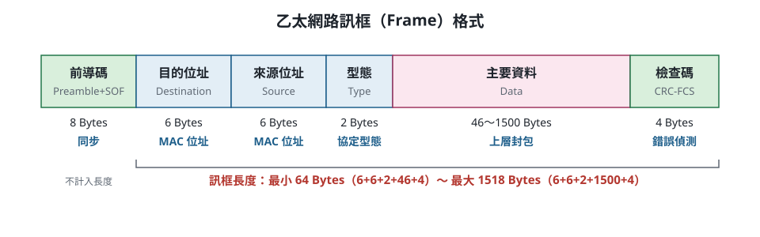

# 第五章 區域網路的主流 — 乙太網路 — 重點整理

> 標記：⭐ 小考已考過　⚠️ 投影片有誤或易混淆　📌 易考數字／名詞

---

- 乙太網路佔企業 LAN **9 成以上**市場；傳統線材為 **Cat 5e UTP**，已逐步升級至 Gigabit

## 5-1 區域網路（LAN）
- 鋪設**私有線路**所建立的網路
- 應用：網路芳鄰、網路磁碟機
- 屬實體接線：**TCP/IP 第 1 層** ↔ **OSI 第 1、2 層**

## 5-2 IEEE 802 標準和 OSI 模型
- IEEE 802 委員會 **1980 年 2 月**成立，推動 LAN 介面與傳輸標準化
- IEEE 802 **只涉及 OSI 的實體層與資料鏈結層**
- ⭐ **資料鏈結層分成兩個子層**：
  | 子層 | 性質 | 標準 |
  |---|---|---|
  | **MAC**（媒介存取控制） | 與網路**實體有關** | 802.3 等 |
  | **LLC**（邏輯鏈結控制） | 與實體**無關** | **802.2** |

### IEEE 802 各標準 📌
| 標準 | 內容 |
|---|---|
| 802.1 | MAC 層橋接共通規範（**802.1Q = VLAN**、**802.1x = 認證**） |
| **802.2** | **LLC** 共通規範 |
| **802.3** | **CSMA/CD 乙太網路** |
| 802.4 | 記號匯流排 Token Bus |
| 802.5 | 記號環 Token Ring |
| 802.6 | 都會網路 MAN（DQDB 分配式佇列雙匯流排） |
| 802.7 | 寬頻技術 |
| 802.8 | 光纖技術 |
| 802.9 | 整合語音與資料網路（ISDN） |
| 802.10 | 網路安全 |
| ⭐ **802.11** | **無線區域網路 WLAN** |
| 802.12 | 需求優先權網路（100BaseVG-AnyLAN） |
| 802.13 | **未定義**（西方忌諱 13） |
| 802.14 | 有線電視網路（Cable Modem） |
| **802.15** | **無線個人網路 PAN**（藍牙） |
| **802.16** | **無線都會網路**（WiMAX） |

### 乙太網路起源
- 美國**全錄 Xerox** 的 **PARC** 於 **1975 年**研製成功，以「乙太（Ether）」命名
- Xerox + **Digital（DEC）** + **Intel** 共同提出規範 → **IEEE 802.3** 的基礎
- 存取方法：**CSMA/CD**（Carrier Sense Multiple Access with Collision Detection，**載波感應多重存取／碰撞偵測**）

### 乙太網路特性
- 速率：10 / 100 / **1000（主流）** / 10000 Mbps
- 媒介：同軸電纜（淘汰）、**雙絞線**、**光纖**
- 拓樸：匯流排（已淘汰）、**星狀**（以 Hub 為中心）
  - ⚠️ 實體是星狀，但**邏輯設計上仍是匯流排**，以**廣播**方式傳遞

### 乙太網路訊框（Frame）結構
- 訊框是**資料鏈結層（OSI 第 2 層）**的資料單位，TCP/IP 對應**網路介面層**
- 傳送的訊框總資料量**最小 64 Bytes** 📌

**欄位順序（由前到後）**

| 順序 | 欄位 | 英文 | 長度 | 用途 |
|---|---|---|---|---|
| 1 | **前導碼** | Preamble + SOF | **8 Bytes** | **同步**（讓接收端對準時脈） |
| 2 | **目的位址** | Destination MAC Address | **6 Bytes** | ⭐ 收件者的 **MAC 位址** |
| 3 | **來源位址** | Source MAC Address | **6 Bytes** | ⭐ 寄件者的 **MAC 位址** |
| 4 | **型態** | Type | **2 Bytes** | **協定型態**（裡面裝的是哪種上層協定） |
| 5 | **主要資料** | Data | **46～1500 Bytes** | 上層傳下來的封包（Payload） |
| 6 | **檢查碼** | CRC-FCS（Frame Check Sequence） | **4 Bytes** | **錯誤偵測** |

**長度計算**（前導碼只負責同步，不算在訊框長度內）
- 最小：6 + 6 + 2 + **46** + 4 = **64 Bytes** ← 投影片說的「最小 64 位元組」
- 最大：6 + 6 + 2 + **1500** + 4 = **1518 Bytes**

> 💡 記順序：**先同步 → 寄給誰 → 誰寄的 → 裝什麼 → 內容 → 最後檢查**（像寄信：對準 → 收件人 → 寄件人 → 物品類別 → 內容 → 封口檢查）
> 💡 記用途：**前導碼 = 同步**；**FCS 的 C = Check 檢查** → 錯誤偵測
> ⚠️ 位址是 **MAC 位址**（第 2 層），不是 IP 位址（IP 在第 3 層封包裡）
> ⚠️ **64 Bytes** 是乙太網路訊框最小長度；**53 Bytes** 是 ATM Cell（第 6 章），別搞混

## 5-3 CSMA/CD 工作原理
- 流程：偵測網路是否忙碌 → 空閒才送 → 偵測碰撞 → 碰撞則停止、等隨機時間重送
- **優點**：原理簡單、易實現；各站**地位平等**、**不需集中控制**、不提供優先順序
- **缺點**：**電纜長度受限**（太長感測不到碰撞）；**使用者越多碰撞機率越高**

## 5-4 乙太網路命名規則：A-B-C ⭐
| 符號 | 意義 | 說明 |
|---|---|---|
| **A** | **傳輸速度** | 單位 Mbps，例 10Base5 = 10 Mbps |
| **B** | **訊號傳輸方式** | **Base = 基頻**、Broad = 寬頻（乙太網路幾乎都是基頻） |
| **C** | ⭐ **傳輸媒介類型** | 數字 × **100 公尺** = 同軸電纜最長區段；英文字代表媒介 |

- C 的英文字：**T = 雙絞線**（100 m）、**F = 光纖**（可達 4 km）、**LX = 長波長雷射**、**SX = 短波長雷射**
- 例：10Base**2** → 約 200 m；10Base**5** → 500 m

## 5-5 乙太網路的演進 📌
| 年代 | 速率 | 名稱 | IEEE 標準 |
|---|---|---|---|
| 1975 | 10 Mbps | 乙太網路 | **802.3** |
| 1995 | 100 Mbps | 高速（Fast）乙太網路 | **802.3u** |
| 1998 | 1000 Mbps | Gigabit 乙太網路 | **802.3z**（光纖、同軸）／**802.3ab**（雙絞線，1999） |
| 2002 | 10000 Mbps | 10 Gigabit 乙太網路 | **802.3ae**（光纖）／**802.3an**（雙絞線，2006） |
| 2010 | 40G / 100G | — | **802.3ba** |

## 5-6 10 Mbps 乙太網路（IEEE 802.3）
| 種類 | 線材 | 接頭 | 最遠距離 | 拓樸 | 狀態 | 備註 |
|---|---|---|---|---|---|---|
| **10Base5** | RG-11 同軸電纜 | **AUI** | **500 m** | 匯流排 | 淘汰 | **標準／粗**乙太網路（Thick），每區段最多 **100 台** |
| **10Base2** | RG-58 A/U 同軸電纜 | **BNC** | **185 m** | 匯流排 | 淘汰 | **細**乙太網路（Thin），每區段最多 **30 台** |
| **10BaseT** | UTP 雙絞線 | **RJ-45** | **100 m** | 星狀 | 尚存 | 透過 Hub 連接 |
| **10BaseF** | 光纖 | **ST** | **2 km** | 星狀 | 尚存 | ST = Straight Tip |

- 10Base5／10Base2 缺點：**任一處斷線整個網路停擺**、難追查 → 由 10BaseT 解決
- 10BaseT 優點：故障只影響該段；看 Hub **燈號**即知哪段故障；移動電腦只改局部佈線

## 5-7 100 Mbps 高速乙太網路（IEEE 802.3u，1995）
| 種類 | 線材 | 接頭 | 距離 | 狀態 | 備註 |
|---|---|---|---|---|---|
| **100BaseTX** | **Cat 5 UTP**（或 STP） | RJ-45 | 100 m | 尚存 | 曾是家庭／企業主流，10BaseT 可直接升級 |
| **100BaseT4** | **Cat 3 UTP（4 對）** | RJ-45 | 100 m | 淘汰 | **半雙工**，非主流 |
| **100BaseFX** | 光纖（多模） | ST | **2 km** | 尚存 | 繼承 10BaseFL |

## 5-8 1000 Mbps Gigabit 乙太網路（802.3z / 802.3ab）
| 種類 | 線材 | 接頭 | 最遠距離 |
|---|---|---|---|
| **1000BaseLX** | **長波長**雷射（1300 nm），**單模或多模**光纖 | SC | **5 km（單模）**／550 m（多模） |
| **1000BaseSX** | **短波長**雷射（850 nm），**只能多模**光纖 | SC | 275 / 550 m |
| **1000BaseCX** | 特殊**同軸電纜** | **DB9** | **25 m**（交換器間短距離，很少用） |
| **1000BaseT** | **Cat 5e** UTP | RJ-45 | 100 m |

- 1000BaseT（802.3ab，1999）支援 Cat 5e 是重大突破，可在原有 Fast Ethernet 系統導入

## 5-9 10 Gigabit 乙太網路（802.3ae / 802.3an）
- **802.3ae**：**2002 年 6 月 12 日**批准（光纖）
  | 模組 | 波長 | 距離 |
  |---|---|---|
  | 10GBase-**SR** | 850 nm 短距離 | 多模 85 m（新型光纖 300 m） |
  | 10GBase-**LR** | 1310 nm 長距離 | 單模 **10 km** |
  | 10GBase-**ER** | 1550 nm 超長距離 | 單模 **40 km** |
  | 10GBase-**LX4** | 1310 nm 附近 4 波長（**WWDM** 寬波長多工） | 多模 300 m／單模 10 km |
- **10GBase-T（802.3an）**：**2006 年 6 月 8 日**通過，用 **Cat 6a（500 MHz）** 以上可傳 **100 m**
  - ⭐ 捨棄 RJ-45，改用 **GG45**（Giga Gate 45）接頭

> ⚠️ LX4 投影片寫「單模 300m、多模 10km」，順序寫反；實際是**多模 300 m、單模 10 km**。

## 5-10 乙太區域網路主流標準
| 線材 | 狀態 | 主流規格 | 過渡規格 |
|---|---|---|---|
| 雙絞線 | **主流** | 1000BaseT(X) | 100BaseTX |
| 光纖 | 距離過長適用 | 1000BaseLX / SX | 100BaseFX |
| 同軸電纜 | **淘汰** | — | — |

## 補充：VLAN（虛擬區域網路）⭐
- **交換式技術的進階應用**；針對**實體層與鏈結層**發展
- 早期各廠商不相容 → IEEE 提出 **802.1Q** 標準
- ⭐ **三大功能**：
  1. **隔離廣播封包**：廣播只在同 VLAN ID 群組內傳送
  2. **突破實體位置限制**：相同 VLAN ID 即同群組，便於管理
  3. **限制存取，提高安全性**
- ⭐ 「增加網路位址設定彈性」**不是** VLAN 三大功能之一
